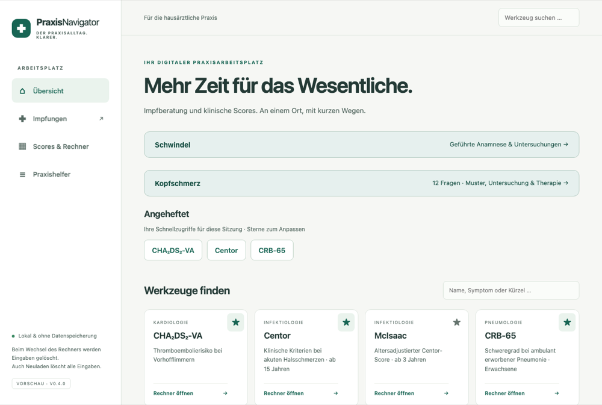

# PraxisNavigator

> **Unvalidated personal prototype. Not in clinical use, not distributed, not a medical device.**

A local prototype for everyday general practice: clinical scores and calculators (for example CHA₂DS₂-VASc,
Centor, McIsaac, CRB-65), each with a source reference, and guided history-taking checklists. The interface is in German.

  

## What it explores

- Finding the right score quickly, by name, symptom or abbreviation.
- Keeping the source next to every calculator.
- Working locally, without storing anything: inputs are cleared when you switch calculators or reload.

## Why

A spare-time experiment by a physician in general-practice training, about which small tools would actually save
time in a consultation.

This repository is a showcase. The source code is not public.

Made by [Sepehr](https://sepehr.digital).
